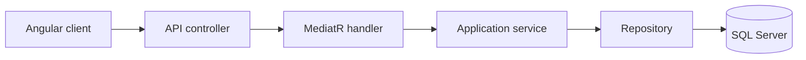

# ParkShare

ParkShare is a thesis web application for renting privately owned parking spaces. Owners publish spaces; renters search, request a booking, and discuss details with the owner. It demonstrates rental coordination using Angular, ASP.NET Core and SQL Server within a limited academic scope.

## Implemented workflow

Owners can create and edit listings with location, size, hourly price, photos and amenities. They manage open and blocked periods through forms and a calendar showing availability windows and confirmed bookings. Renters can search by location, price, requested period and amenities, explore linked list/map results, and view listing details and reviews.

A request starts a pending booking and enables participant-only chat. The owner receives an in-app notification and can approve or reject it. Approval represents confirmation of the agreement: the period becomes unavailable for overlapping requests, and overlapping pending requests are rejected. Renters receive decision notifications. After the booking ends, the owner can mark it completed, allowing the renter to create or edit a rating and comment.

Payments are outside the workflow. The booking entity retains a `PaymentStatus` placeholder, as specified in the thesis brief.

## Repository structure

| Location | Responsibility |
| --- | --- |
| [WebClient/ng-app](WebClient/ng-app/) | Angular screens, navigation, forms, API clients, session recovery and Leaflet map interaction. |
| [ParkShare.Api](ParkShare.Api/) | HTTP endpoints, authenticated request context, API mappings and application startup. |
| [ParkShare.Application](ParkShare.Application/) | Commands, queries, handlers, validation, application DTOs, business services and persistence interfaces. |
| [ParkShare.Domain](ParkShare.Domain/) | Entities and relationships for users, listings, availability, bookings and related records. |
| [ParkShare.Infrastructure](ParkShare.Infrastructure/) | EF Core context/migrations, SQL repositories, token/password helpers, photo storage and place lookup. |
| [ParkShare.Shared](ParkShare.Shared/) | Request/result contracts exchanged at the API boundary. |
| [ParkShare.Common](ParkShare.Common/) | Shared enums, constants and extensions. |
| [ParkShare.Tests](ParkShare.Tests/) | Executable regression suite using real SQL Server persistence. |

## Architecture

Typical business request flow:

Controllers translate HTTP requests into application operations. MediatR handlers delegate to services, which enforce business rules and coordinate repositories. EF Core handles relational persistence. Separating these responsibilities keeps HTTP concerns out of booking rules and database details out of the client.

CQRS organizes reads as queries and changes as commands within one backend and one database. It does not introduce event sourcing or separate read/write databases. This provides explicit use cases without requiring distributed infrastructure. FluentValidation checks input, while services enforce rules that depend on current data. `ServiceResult<T>` carries payloads or failures, including conflict classification, through handlers to the API. AutoMapper handles conversions between boundary models.

## Design decisions

### Consistent booking decisions

Concurrent approval requests must not confirm overlapping periods for the same listing. Booking mutations therefore use application-owned transactions and acquire a lock on the listing row before checking fresh ownership, status, time and availability. Related listing and availability writes use the same boundary. Booking changes and their notification records commit together, avoiding a successful decision without its corresponding notification.

### Identity and browser sessions

Accounts can hold both renter and owner roles; creating the first listing adds the owner role. Protected operations derive identity from the authenticated token and check resource ownership or participation. Passwords use salted ASP.NET Core password hashes. Existing legacy credentials are converted transactionally before startup accepts requests, with no plaintext login fallback.

The client stores tokens in browser storage and coordinates session recovery. Protected pages, the landing route and recovery route render on the client because authentication is browser-local; login and registration are prerendered. These choices support the local demonstration while leaving a broader production session-management design for future work.

### Discovery and communication

Leaflet displays OpenStreetMap tiles; server-side Geoapify lookup provides place search without exposing its credential in the client. Search criteria are explicitly applied, and panning retains camera state until the user requests a search of the visible area. Linked cards and marker previews let renters compare results before opening details.

Chat belongs to a booking and checks participation, so communication begins only after a request exists. In-app notifications communicate booking events. Ratings are limited to the renter of a completed booking, tying reviews to recorded use rather than unrestricted submissions.

## Thesis conventions and boundaries

The implementation uses Angular 21 and .NET 10; the original brief named .NET 8. This is a framework-baseline update within the same C#/ASP.NET Core architecture. Marker clicks select a preview with a **View space** link, rather than navigating immediately as described in the brief.

Place search targets Greece with an Athens bias, while prices use RON and booking periods follow Romanian local time. These are explicit demonstration conventions, not a multi-country currency or timezone model. Period-filtered discovery checks availability for the requested interval; undated results represent active listings rather than a guarantee of immediate availability.

The prototype retains manual chat/calendar refresh, local photo storage, stateless refresh tokens, browser storage and per-tab refresh coordination. Booking history displays current listing details rather than historical snapshots. Maps and calendars aggregate matching pages; this is not evidence of large-scale performance. Token revocation, cloud storage, historical snapshots and bounded geographic/calendar loading are possible future improvements.

Real payments, email/push delivery, verification/2FA, a support centre and owner-to-renter reviews were excluded from the brief. Cancellation and profile editing are not required workflows. Existing richer search controls extend the basic brief without making further commercial features necessary.

AutoMapper is used for concise mapping in this non-commercial academic project.

## Verification approach

Tracked Angular specifications cover client behavior. The [SQL regression runner](ParkShare.Tests/README.md) exercises persistence, concurrency, isolation and failure handling against a uniquely created test database. It is an executable assertion suite rather than a conventional test-framework project.

Local browser acceptance tests cover owner/renter journeys, recovery and responsive layouts; their configuration and files are not included in the checkout. These checks were not rerun for this documentation change.
